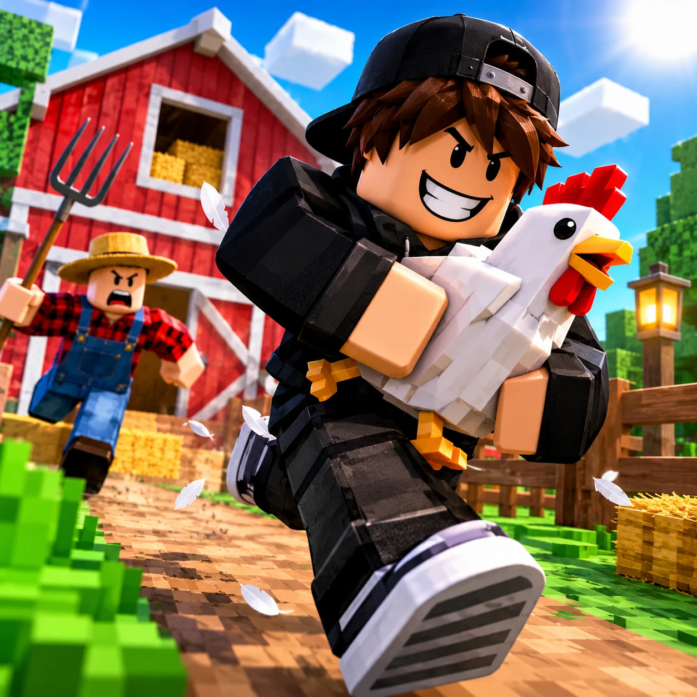
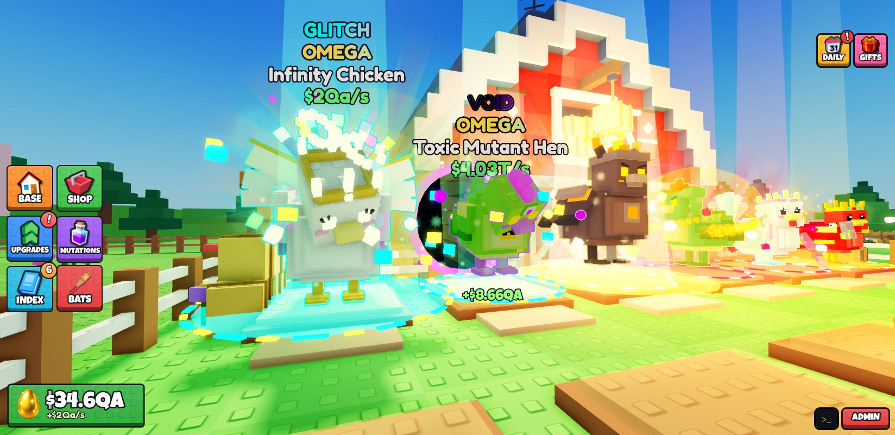
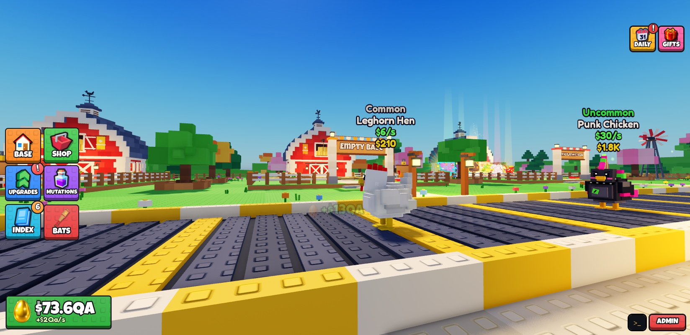
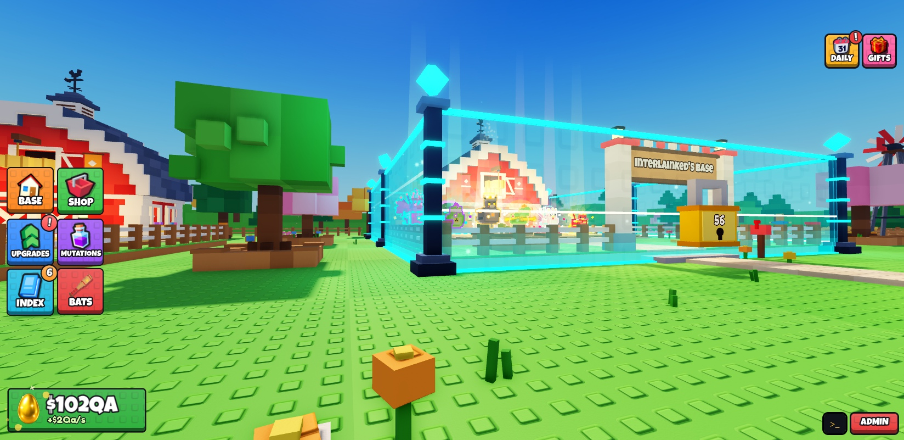
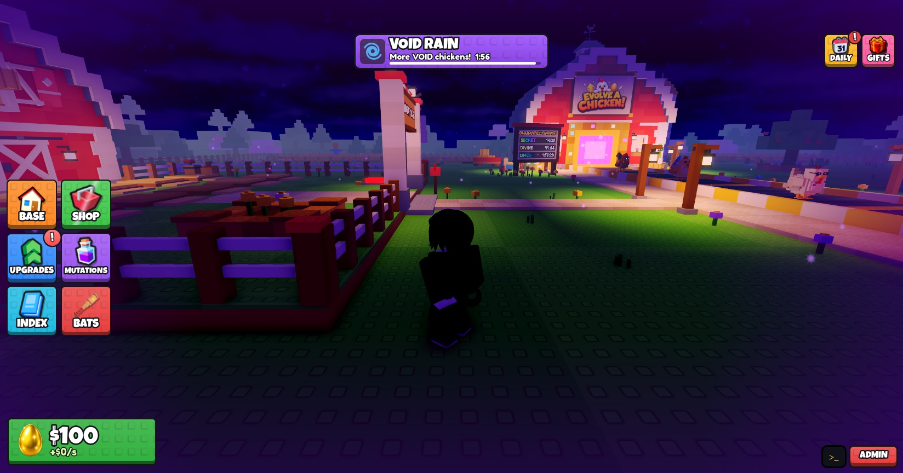
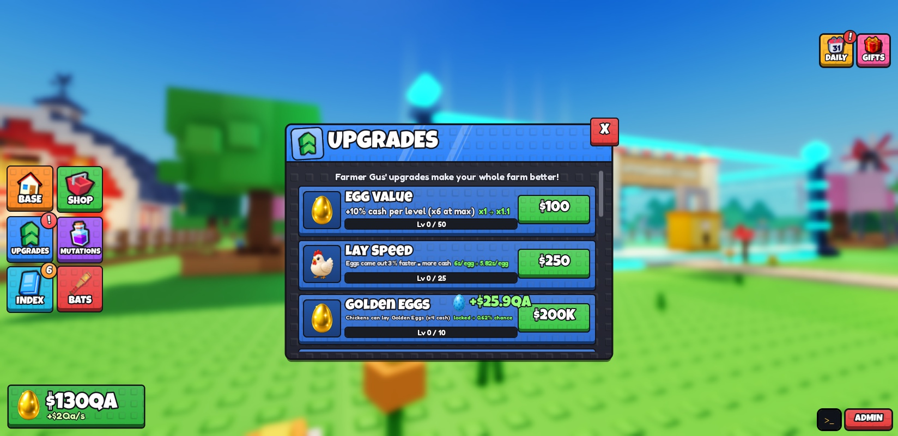

<div align="center">

# 🐔 Evolve a Chicken

**A multiplayer tycoon for Roblox: buy chickens off a conveyor, evolve them through 100 stages, collect rare eggs, and defend your farm from thieves.**


Developed by **MCK Studio**

<!-- Key art. Add real gameplay screenshots below if you have them -->


</div>

> **About this repository.** This is a **portfolio showcase**. It contains the project overview and a curated set of
> source files that represent the codebase. The full game (41 scripts, ~21,500 lines of Luau) lives in a private
> repository. **Full source is available on request.**

---

## Table of Contents

- [Overview](#overview)
- [Code Samples](#code-samples)
- [Screenshots](#screenshots)
- [Core Gameplay Loop](#core-gameplay-loop)
- [Features](#features)
- [Technical Highlights](#technical-highlights)
- [Architecture](#architecture)
- [Game Systems in Detail](#game-systems-in-detail)
- [Monetization](#monetization)
- [Art & Content Pipeline](#art--content-pipeline)
- [Development Process](#development-process)
- [Contact](#contact)

---

## Overview

**Evolve a Chicken** is a multiplayer tycoon in a blocky, stud-textured art style. Up to 8 players share a server, and each
one owns a farm. Chickens of different rarities ride a central conveyor; players buy them, place them in their base and earn
money from the eggs they lay. Three identical chickens fuse into the next stage of a **100-chicken evolution chain**.

On top of the tycoon loop sits a **PvP layer**. Other players can walk into your base and steal your chickens, and you defend
the farm by bonking thieves with a bat or by raising a force-field lock.

| | |
|---|---|
| **Genre** | Tycoon / Idle / Social PvP |
| **Players** | 1–8 per server |
| **Engine** | Roblox (Luau) |
| **Codebase** | 41 scripts, ~21,500 lines of Luau (full, private) |
| **Ownership** | MCK Studio (Roblox group) |

---

## Code Samples

Five files from the real codebase, chosen to show different skills. They are excerpts: they depend on other modules
(such as `Config`) that are not included, so they won't run on their own.

| File | Side | What to look at |
|---|---|---|
| [`DataService.luau`](code/ServerScriptService/Modules/DataService.luau) | Server | Player persistence with retries, `UpdateAsync`, and a guard that **never saves over a profile that failed to load** (prevents data wipes during DataStore outages). |
| [`RewardService.luau`](code/ServerScriptService/Modules/RewardService.luau) | Server | Retention systems: a 7-day daily-reward streak, playtime gifts and capped offline income. All state is computed server-side and exposed to the UI through attributes. |
| [`WeatherService.luau`](code/ServerScriptService/Modules/WeatherService.luau) | Server | A small, isolated service. World state is published as `workspace` attributes so every client renders it, and the service never touches the economy. |
| [`CashModels.luau`](code/ReplicatedStorage/CashModels.luau) | Shared | Procedural 3D models built from code, rendered in `ViewportFrame`s, plus an algorithm that detects coplanar faces and resolves **z-fighting** (biggest-to-smallest ordering, so fixes never undo each other). |
| [`LockShield.luau`](code/ReplicatedStorage/LockShield.luau) | Client | Visual-only state machine (lock → locked → hit → unlock) driven by server attributes: shield generators, energy walls, a countdown padlock and impact ripples. |

---

## Screenshots

| | |
|:---:|:---:|
| <br>**Rare chickens with rarity auras and mutations** | <br>**The conveyor ("Chicken Road")** |
| <br>**Base lock: shield generators, energy walls and countdown padlock** | <br>**Weather event: Void Rain** |
| <br>**Upgrade shop** | |

---

## Core Gameplay Loop

```
   ┌──────────────┐     buy      ┌──────────────┐    lay eggs    ┌──────────────┐
   │ Chicken Road │ ───────────▶ │  Your Base   │ ─────────────▶ │  Collect $   │
   │  (conveyor)  │              │  (12 nests)  │                │              │
   └──────────────┘              └──────┬───────┘                └──────┬───────┘
          ▲                             │ fuse 3 → 1                    │
          │                             ▼                               ▼
          │                      ┌──────────────┐              ┌──────────────┐
          └───── steal ───────── │  Evolution   │              │   Upgrades   │
           (from other players)  │  & Mutations │              │ & Game Passes│
                                 └──────────────┘              └──────────────┘
```

1. **Buy**: chickens spawn on the conveyor with rarity-weighted odds and walk to your base once bought.
2. **Earn**: every chicken periodically lays an egg. Egg rarity (White → Rainbow) multiplies its value.
3. **Evolve**: fuse 3 identical chickens into the next stage of the chain.
4. **Upgrade**: spend money on permanent upgrades.
5. **Steal & defend**: grab chickens from other bases, or lock yours and bonk intruders.

---

## Features

### Gameplay
- 🐣 **100 chickens across 9 rarities**, from Common to Omega
- 🧬 **Evolution chain**: fuse 3 identical chickens into the next stage
- 🥚 **6 egg rarities** with value multipliers up to ×25
- ✨ **9 mutations** that multiply income from ×2 to ×15. They appear on the conveyor, during weather events, or at the Mutation Lab.
- 🌧️ **9 weather events** (Lava Rain, Thunderstorm, Toxic Rain, Crystal Snow, Shadow Night, Cyber Rain, Glitch Storm, Solar Flare, Void Rain)
- ⏱️ **Guaranteed rare spawns** on server-wide timers (Secret, Divine, Omega)
- 🦹 **Stealing**, with an escape route enforced by physics. Thieves can only leave through the front gate.
- 🏏 **Bonk Bat** with 18 unlockable skins
- 🔒 **Force-field base lock** that pushes intruders out
- ⬆️ **12 upgrades** with data-driven cost and effect curves

### Progression & Retention
- 📖 **Chicken Index** with one tab per mutation, and permanent bonuses for completing a rarity
- 🎁 **Daily rewards** (7-day streak), **playtime gifts** and **offline income**
- 🏆 **Global leaderboards** backed by `OrderedDataStore`
- 🎓 **Server-validated onboarding tutorial**
- 🧑‍🌾 **NPC shopkeepers** with dialog trees

### Presentation
- **Procedurally built chickens** made of studded blocks in code, on a jointed rig
- **Chicken animation**: idle, pecking, looking at players, waddling, and panic when carried
- **Rarity auras** that escalate with tier
- Animated stud-style UI with a phone-friendly layout

---

## Technical Highlights

| Area | What was done |
|---|---|
| **Server authority** | Economy, ownership, combat and tutorial progress all run on the server. Clients only send *intents*, which the server validates before acting. |
| **Data safety** | Retried loads, `UpdateAsync` saves, and no save over a profile that failed to load. New fields are reconciled on load, so old saves keep working. |
| **Idempotent purchases** | Recent `PurchaseId`s are stored per player, so a developer product is never granted twice. |
| **Physics-enforced rules** | Collision groups make invisible walls solid *only* for players carrying a stolen chicken. |
| **Attribute-driven clients** | The server publishes state as Instance attributes. Weather, the lock shield, auras and timers are pure client-side visuals that read only those attributes. |
| **Layered admin security** | A server-side permission list with two levels, commands re-checked on the server, and a staff panel that is gated by group role, rate-limited, logged and isolated from economy code. |
| **Config-driven design** | One `Config` module holds all game data. Upgrade effects are pure functions of level, shared by the server and the UI. |
| **Performance** | Animations and auras run only for chickens near the camera and on screen. |
| **Rendering fixes** | A spatial-hash scan over ~19,000 parts fixes z-fighting, including parts that standard spatial queries skip. |

---

## Architecture

```
┌──────────────────────────── Server (ServerScriptService) ────────────────────────────┐
│  GameServer ────────┬─ plots, slots, conveyor     Modules/                           │
│   (main loop)       ├─ eggs & collection          ├─ DataService    (persistence) ★  │
│                     ├─ evolution & mutations      ├─ ChickenFactory (models, eggs)   │
│                     ├─ stealing / bat / lock      ├─ WeatherService (events)      ★  │
│                     ├─ upgrades & tutorial        ├─ RewardService  (retention)   ★  │
│                     └─ MarketplaceService         ├─ IndexService   (index prizes)   │
│  Leaderboards · AdminService                      └─ AdminCommands / AdminList       │
└──────────────────────────────────▲───────────────────────────────┬──────────────────┘
                                   │ Remotes (validated intents)    │ Attributes
┌──────────────────────────────────┴───────────────────────────────▼──────────────────┐
│ Client: UIController · TutorialClient · RewardsClient · WeatherClient · WorldClient  │
│         ChickenAnimator · ChickenAuraClient · ChickenFXClient · LockShieldClient     │
└──────────────────────────────────────────────────────────────────────────────────────┘
 Shared: Config · ChickenBuilder · BatBuilder · CashModels ★ · LockShield ★ · UIStyle

 ★ = included in this repository
```

---

## Game Systems in Detail

<details>
<summary><b>Economy & progression</b></summary>

- An egg's value is `Income × LayInterval × EggRarityMult × Upgrades × Mutation × Passes × IndexBonus`.
- Upgrade cost is `BaseCost × CostMult ^ level`. Income upgrades scale into the late game, while utility upgrades max out mid-game.
- Prices grow faster than income along the chain, so progression stays exponential without becoming instant.

</details>

<details>
<summary><b>Stealing & defense</b></summary>

- A thief carries the chicken above their head with reduced speed, and can only leave through the victim's front gate.
- Delivering the chicken to your own base completes the steal. Getting bonked, dying or timing out fails it.
- The base lock raises a force field for a duration set by upgrades and pushes non-owners out.

</details>

<details>
<summary><b>Rarity, mutations & weather</b></summary>

- Conveyor spawns use weighted rarity tables, and a paid server-wide luck boost doubles rare odds.
- Guaranteed spawns force a Secret, Divine or Omega chicken onto the conveyor on fixed intervals.
- Weather events spread their mutation to chickens on the road, and the Mutation Lab can roll one on any chicken.

</details>

---

## Monetization

Purchases speed up the economy but never buy PvP power: stealing and defense can't be bought.

| Type | Items |
|---|---|
| **Game Passes** | 2x / 3x / 5x / 10x Cash (an upgrade chain where only the highest one owned applies), Auto Collect, VIP |
| **Developer Products** | Cash packs that scale with player income (and can be gifted), Golden Hen, Server Luck x2 |

---

## Art & Content Pipeline

- **Chickens and bats** are built entirely in code from studded blocks on a jointed rig, so 100 chickens and 18 bat skins share one style and one animation system.
- **The map** is built procedurally, followed by an automated z-fighting cleanup pass.
- **2D icons and logo** were generated with Higgsfield as green-screen sprite sheets, then processed by a custom **PowerShell/C# tool** (flood-fill chroma key, connected-component slicing, trimming).

---

## Development Process

The project was built by **MCK Studio** using an iterative, playtest-driven workflow. The team owned game design, art
direction, balancing and monetization decisions, and tested every change in Roblox Studio.

Development made heavy use of **AI-assisted programming** (Anthropic's Claude, via Claude Code connected to Roblox Studio
through MCP) for implementation, debugging and tooling.

---

## Contact

- **Matheus Soares Beraldo** · GitHub [@mathhhe](https://github.com/mathhhe)

Interested in the full source? Get in touch and I'll grant access to the private repository.

<div align="center">

*Roblox is a trademark of Roblox Corporation. This project is not affiliated with or endorsed by Roblox Corporation.*

</div>
